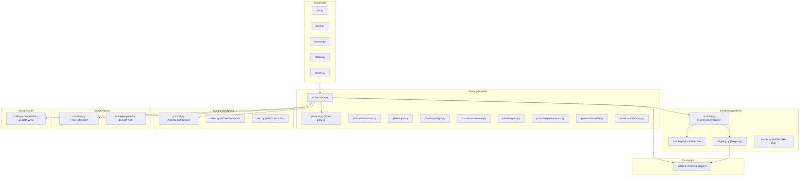
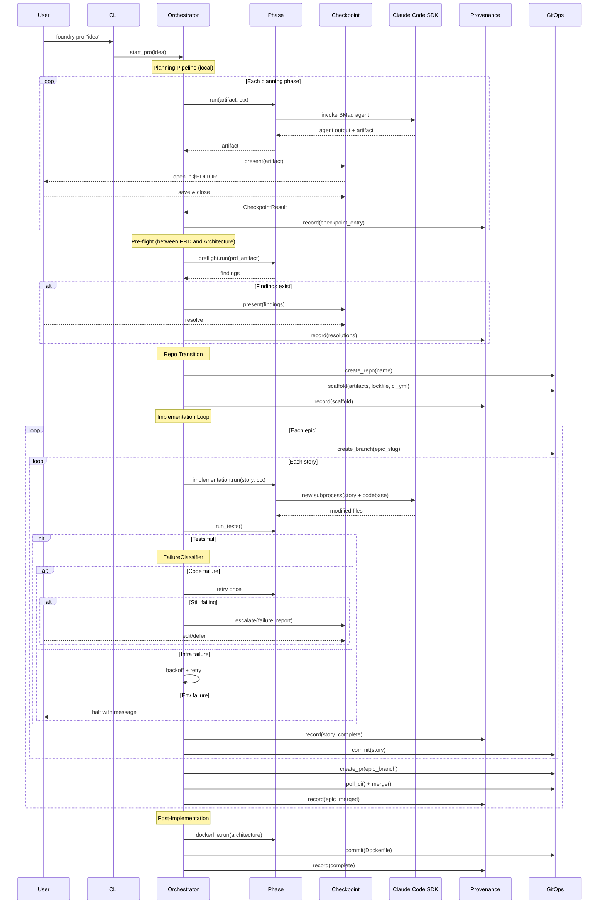
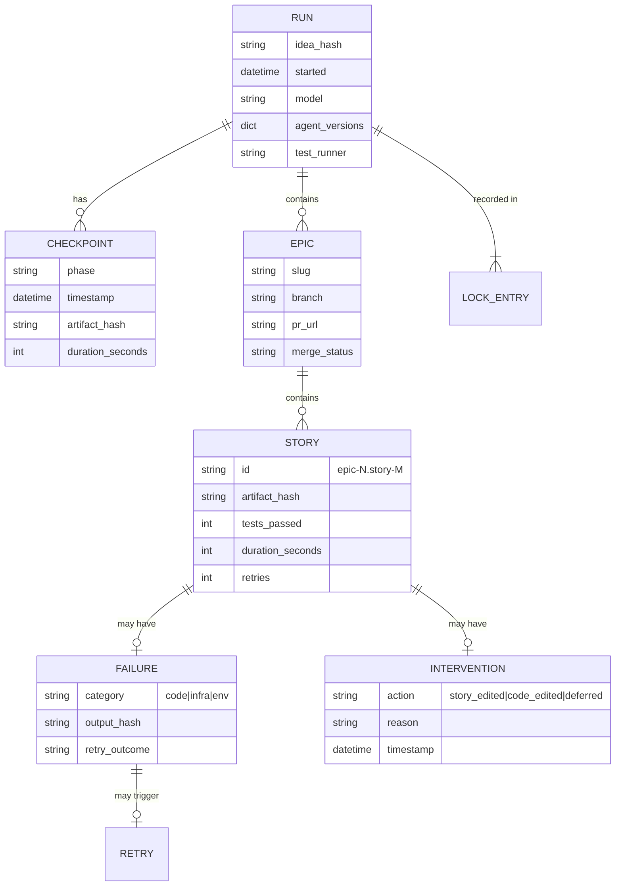

# Architecture Spine — Foundry CLI

## Design Paradigm

**Pipes-and-filters.** Each phase (brainstorm, PRD, architecture, epics, implementation) is a filter: it receives an artifact, invokes an agent or process, produces the next artifact. The orchestrator is the pipeline that connects filters in sequence, manages checkpoints between them, and records provenance at each joint. Filters are stateless; all state lives in the two sinks (foundry.lock and git).

Layers map to packages:

```
foundry/
  cli/          # Typer commands — thin dispatch, no logic
  pipeline/     # Orchestrator, phase protocol, phase implementations
  provenance/   # LockfileWriter, ForgeLog, artifact hashing
  checkpoint/   # CheckpointHandler protocol + $EDITOR and web UI implementations
  failure/      # FailureClassifier, retry strategies per category
  git/          # GitOps adapter (local git + PyGitHub remote)
  state/        # aiosqlite WAL for in-flight state
```

## Invariants & Rules

### AD-1 — Pipes-and-filters phase isolation

- **Binds:** FR-7 through FR-10, FR-35 (all pipeline phases)
- **Prevents:** Phase coupling — one phase importing logic from another, or sharing mutable state between phases
- **Rule:** Every phase implements the `Phase` protocol: `async def run(self, input: Artifact, ctx: RunContext) -> Artifact`. Phases receive an artifact and produce an artifact. They may call external services (Claude Code SDK, LLM) but never call other phases directly. The orchestrator owns sequencing.

### AD-2 — Dual-sink provenance: every mutation writes to both sinks

- **Binds:** FR-25 through FR-29, NFR-8
- **Prevents:** Silent state changes — an action recorded in git but not in the lock file, or vice versa
- **Rule:** Every state mutation passes through `ProvenanceRecorder`, which writes to both `LockfileWriter` (TOML append) and `ForgeLog` (git commit) atomically. No component writes directly to foundry.lock or makes a git commit outside this path. The recorder enforces NFR-8: if either sink fails, the operation fails.

### AD-3 — Failure classification before propagation

- **Binds:** FR-21, FR-22, FR-23, FR-24, NFR-4
- **Prevents:** Infrastructure errors reaching the LLM for "fixing"; environment errors entering the retry loop; code errors being silently swallowed
- **Rule:** A `FailureClassifier` wraps every external call (Claude Code SDK, GitHub API, subprocess, network). It classifies the error *before* returning it to the orchestrator. The orchestrator dispatches to the correct handler based on category — never inspects raw exceptions. Classification rules:

```
Code failure:     test runner returns non-zero exit
Infrastructure:   HTTP 429, 5xx, timeout, connection refused, rate limit headers
Environment:      auth failure (401/403), disk full, model not found, invalid config
```

### AD-4 — Checkpoint protocol with swappable implementations

- **Binds:** FR-7 through FR-10, FR-31, FR-35
- **Prevents:** Checkpoint logic leaking into phase code; the web UI and $EDITOR diverging in behavior
- **Rule:** `CheckpointHandler` is a protocol: `async def present(self, artifact: Path, metadata: dict) -> CheckpointResult`. `CheckpointResult` carries: the (potentially edited) artifact path, the artifact hash post-edit, editor open/close timestamps. Two implementations: `EditorCheckpoint` (opens `$EDITOR`, blocks until exit) and `WebCheckpoint` (starts local HTTP server, opens browser, blocks until "Approve" click). The orchestrator receives a `CheckpointHandler` at construction; phases call `ctx.checkpoint(artifact)` and get back the result. `[ASSUMPTION: WebCheckpoint uses a single-page app with a markdown editor; framework TBD — likely a lightweight Python server (uvicorn + starlette) serving a bundled HTML page with a JS markdown editor.]`

### AD-5 — Append-only foundry.lock structure

- **Binds:** FR-25, NFR-2, NFR-5, Open Question #4 (merge conflicts)
- **Prevents:** Merge conflicts when epic branches merge to main; corruption from concurrent writes; loss of provenance on crash
- **Rule:** foundry.lock sections are addressed by dotted keys that are unique and never reused: `[checkpoints.brainstorm]`, `[implementation.epic-1.story-2]`, `[failures.epic-1.story-3.retry-1]`. No section is ever edited after being written. New entries append new TOML sections. This means: (a) epic branches never touch the same TOML keys as main, so merges are conflict-free; (b) atomic writes (temp + rename) preserve validity on crash; (c) resume reads the last entry to determine position.

### AD-6 — aiosqlite as ephemeral WAL, not source of truth

- **Binds:** NFR-4, NFR-5
- **Prevents:** Drift between the committed lock file and in-flight state; a database file accidentally committed
- **Rule:** `StateBuffer` uses aiosqlite to track in-progress operations (current story, current retry count, pending lock entries). On each successful story completion, it flushes to `LockfileWriter` (which does the atomic write + git commit). The `.foundry/state.db` file lives in the `.foundry/` directory (`.gitignore`d) and is re-derivable from foundry.lock + git log on resume.

  **Crash recovery procedure (invoked by `foundry resume`):**

  1. Read foundry.lock to determine the story manifest and the last recorded `[implementation.*]` entry. The next story after the last recorded entry is the resume point.
  2. Run `git status`. Three cases:
     - **Clean working tree:** No in-flight work survived the crash. Resume by running the next uncompleted story from scratch.
     - **Dirty working tree, changes in tracked files:** A Claude Code session completed but Foundry crashed before committing. Run the test runner against the current state. If **green**: commit the changes as the interrupted story (normal forge-log message + lock entry) and advance to the next story. If **red**: `git checkout .` to discard the uncommitted changes, then re-run the story from scratch.
     - **Dirty working tree, only untracked files:** Same as dirty-tracked: run tests, commit if green, discard and re-run if red.
  3. Rebuild `.foundry/state.db` from the now-current foundry.lock state and continue the implementation loop.

  This means: at worst, a crash costs one story re-run. No story is ever half-committed or double-committed.

### AD-7 — One Claude Code subprocess per story

- **Binds:** FR-17
- **Prevents:** Context leakage between stories; a hung session blocking subsequent stories; unbounded memory growth from accumulated context
- **Rule:** Each story implementation spawns a new Claude Code SDK session via the Python API. The invocation contract:

  1. Foundry assembles a **prompt file** at `.foundry/current-story.md` in the repo working directory. Contents: story text, acceptance criteria, and the full architecture document (inlined, not a path reference — the agent should not need to locate files to understand its task).
  2. The Claude Code SDK is invoked with `cwd` set to the repo root. The SDK reads and writes files in the working directory directly — Foundry does not mediate file I/O.
  3. On session completion (success or failure), Foundry deletes `.foundry/current-story.md` before running tests. The `.foundry/` directory is `.gitignore`d.
  4. No session state, conversation history, or tool-use context persists between stories. Each invocation starts cold.

  This means the Claude Code agent sees the *current codebase on disk* (including all prior stories' committed changes) as its sole context for what exists. The prompt file is the sole context for what to build.

### AD-8 — GitOps adapter owns all repository mutations

- **Binds:** FR-14 through FR-16, FR-19, FR-20, FR-29, NFR-6
- **Prevents:** Scattered git/GitHub calls with inconsistent error handling; credentials leaking into non-git code paths
- **Rule:** `GitOps` is the sole component that executes git commands (via subprocess) and GitHub API calls (via PyGitHub). It exposes domain methods: `create_repo()`, `scaffold()`, `create_branch()`, `commit()`, `create_pr()`, `merge_pr()`, `poll_ci()`. Credentials (GitHub token) are read from environment at `GitOps` construction and never exposed beyond it. All other components pass `GitOps` the content; it handles the git/GitHub mechanics.

### AD-9 — Planning runs locally; repo is a one-time transition

- **Binds:** FR-7 through FR-10, FR-14, FR-15
- **Prevents:** A failed planning phase leaving an empty GitHub repo; wasted GitHub API calls during iterative planning; planning artifacts diverging from what's committed
- **Rule:** The planning pipeline (brainstorm → PRD → pre-flight → architecture → epics) runs in a local temp workspace under `~/.foundry/runs/<run-id>/`. No GitHub repo exists during planning. After architecture approval, the orchestrator calls `GitOps.create_repo()` + `GitOps.scaffold()`, which copies all planning artifacts into the scaffold commit. From this point forward, all work happens in the cloned repo directory.

### AD-10 — Pre-flight analysis is a pipeline phase, not a side-check

- **Binds:** FR-11, FR-12, FR-13
- **Prevents:** Pre-flight being skippable or running at the wrong time; its findings not being recorded in provenance
- **Rule:** Pre-flight is a phase in the pipeline, positioned between PRD and architecture. It follows the same `Phase` protocol: receives the approved PRD artifact, produces a pre-flight report. If findings exist, it triggers a checkpoint (the report opens in `$EDITOR`). The human's resolutions are recorded in foundry.lock under `[checkpoints.preflight]`. Only after all findings are resolved does the pipeline advance to architecture.

## Consistency Conventions

| Concern | Convention |
| --- | --- |
| Naming (files) | `snake_case.py` for modules, `kebab-case` for CLI commands and epic branch slugs |
| Naming (code) | PEP 8: `snake_case` functions/variables, `PascalCase` classes, `UPPER_SNAKE` constants |
| Data formats (IDs) | Dotted path IDs in foundry.lock: `epic-1.story-2`, `checkpoints.brainstorm` |
| Data formats (dates) | ISO 8601 UTC everywhere: `2026-10-28T14:30:00Z` |
| Data formats (hashes) | `sha256:<hex>` prefixed strings |
| Error shapes | `FoundryError` base; `CodeFailure`, `InfraFailure`, `EnvFailure` subclasses; each carries `category`, `message`, `context: dict` |
| State mutation | Always through `ProvenanceRecorder`; never write foundry.lock or git commit directly |
| Config | Environment variables for credentials (`GITHUB_TOKEN`, `ANTHROPIC_API_KEY`); foundry.lock for run config; no config files |
| Logging | `structlog` JSON to stderr; structured fields: `phase`, `story_id`, `action`, `duration_ms` |

## Stack

| Name | Version |
| --- | --- |
| Python | ≥3.11 (tomllib in stdlib) |
| Typer | ≥0.15 |
| Claude Code SDK | latest (Python SDK) |
| PyGitHub | ≥2.6 |
| aiosqlite | ≥0.20 |
| tomli-w | ≥1.1 (TOML writing; stdlib tomllib is read-only) |
| structlog | ≥24.1 |
| uvicorn + starlette | latest (web checkpoint server) `[ASSUMPTION]` |
| pytest | dev dependency; Foundry's own tests |

## Structural Seed



```text
foundry/
  __init__.py
  __main__.py          # python -m foundry
  cli/
    __init__.py
    pro.py             # foundry pro "<idea>"
    quick.py           # foundry quick "<idea>"
    resume.py          # foundry resume
    status.py          # foundry status
    cancel.py          # foundry cancel
  pipeline/
    __init__.py
    orchestrator.py    # Sequences phases, manages run lifecycle
    protocol.py        # Phase protocol, Artifact, RunContext
    phases/
      __init__.py
      brainstorm.py    # BMad brainstorm agent call
      prd.py           # BMad PRD agent call
      preflight.py     # Contradiction/completeness/traceability
      architecture.py  # BMad architecture agent call
      epics.py         # BMad epics/stories agent call
      implementation.py # Per-story Claude Code loop
      dockerfile.py    # Post-impl Dockerfile generation
      consistency.py   # Model-boundary style normalization
  provenance/
    __init__.py
    recorder.py        # Dual-sink writer (lock + git)
    lockfile.py        # Atomic TOML append writer
    forgelog.py        # Structured commit message builder
    hasher.py          # SHA-256 artifact hashing
  checkpoint/
    __init__.py
    protocol.py        # CheckpointHandler protocol
    editor.py          # $EDITOR implementation
    web.py             # Local server implementation
    assets/            # Bundled HTML/JS for web checkpoint
  failure/
    __init__.py
    classifier.py      # Error → category classification
    strategies.py      # CodeRetry, InfraBackoff, EnvHalt
  git/
    __init__.py
    gitops.py          # All git/GitHub operations
  state/
    __init__.py
    buffer.py          # aiosqlite ephemeral WAL
tests/
  ...
pyproject.toml
```

### System Flow



### Entity Relationships



## Capability → Architecture Map

| Capability / FR | Lives in | Governed by |
| --- | --- | --- |
| FR-1..6 (CLI commands) | `cli/` | AD-1 (thin dispatch) |
| FR-7..10 (Planning pipeline) | `pipeline/phases/` | AD-1, AD-9 |
| FR-11..13 (Pre-flight) | `pipeline/phases/preflight.py` | AD-10 |
| FR-14..15 (Repo + scaffold) | `git/gitops.py` | AD-8, AD-9 |
| FR-16..20 (Implementation loop) | `pipeline/phases/implementation.py`, `git/` | AD-1, AD-7, AD-8 |
| FR-21..24 (Failure taxonomy) | `failure/` | AD-3 |
| FR-25..28 (foundry.lock) | `provenance/lockfile.py` | AD-2, AD-5 |
| FR-29 (Forge log) | `provenance/forgelog.py` | AD-2 |
| FR-30 (Dockerfile) | `pipeline/phases/dockerfile.py` | AD-1 |
| FR-31 (Web UI checkpoint) | `checkpoint/web.py` | AD-4 |
| FR-32..34 (Resume) | `pipeline/orchestrator.py`, `state/` | AD-6 |
| FR-35..36 (Quick mode) | `pipeline/orchestrator.py`, `pipeline/phases/` | AD-1 |
| FR-37 (CI workflow) | `git/gitops.py` | AD-8 |

## Deferred

| Decision | Why it can wait |
| --- | --- |
| Web checkpoint framework choice | $EDITOR is v1 default; web UI is SHOULD. Pick when implementing FR-31. |
| Plugin architecture for builder agents | v1 only supports Claude Code SDK. Provider-agnostic slot is v2. |
| foundry.yaml schema | COULD scope. Declarative process config adds no value until the pipeline shape is proven. |
| `--from-prd` ingest format | COULD scope. Requires defining what "PRD" means across formats. |
| `foundry reverse` architecture | WON'T for v1. Completely different data flow (code → spec, not spec → code). |
| DAG/backtracking pipeline topology | WON'T for v1. Current linear pipeline is simpler and sufficient. |
| Secret scanner implementation | Assumed in PRD (§9 guardrails). Exact pattern set and library TBD at implementation. |
| Multi-org GitHub support | v1 creates repos under personal account only. Org routing adds auth complexity. |
| Consistency pass trigger heuristics | v1 triggers only on model version change. Style drift detection without a model change is v2. |
